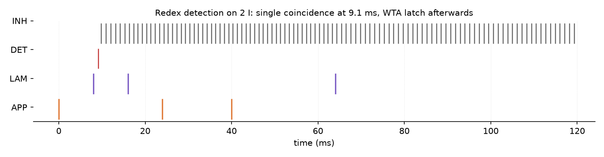
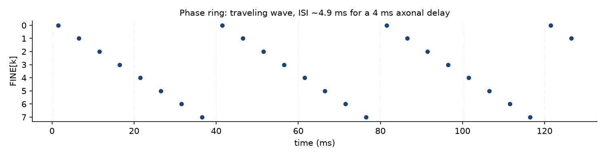

# Spiking lambda-calculus beta-reduction: an independent reproduction

An independent, from-scratch reproduction of the fully spiking neural
implementation of lambda-calculus beta-reduction presented in
[arXiv:2611.23182v1](https://arxiv.org/abs/2611.23182v1) (Lazovskiy,
Kazantsev, Stasenko, November 2026). No code from the authors was
available, so every circuit was rebuilt from the paper's Section 2 and
validated against a symbolic oracle.

Two engines implement the same neural semantics:

* a pure-Python engine (standard library only), used as the reference;
* a bit-faithful C core (`snn_core.c`) driven through ctypes, verified
  spike-for-spike against the Python engine.

Every stage of Algorithm 1 runs on real simulated neurons: Jeffress
delay-line redex detection with a WTA latch, a tau_m = 300 ms balance
counter for subterm segmentation, theta-gamma variable binding, a
phase-ring for De Bruijn arithmetic, theta-cycle STDP token copying, and
PERSIST/GATE/SCAN orchestration.

## Validation highlights

* Calibration reproduced exactly: epsilon(2,1) = 0.263, epsilon(10,2) =
  0.137, epsilon(300,1) = 0.00344 (difference 0.0 between engines).
* The closed loop normalises the paper's terms in the same number of
  reduction steps: PLUS 1 1 in 6, MULT 2 2 in 7, MULT 2 3 in 7, PRED 3 in
  11, if-true (2 I) omega in 8. The `2 I` trace is 10 -> 8 -> 5 -> 2
  tokens.
* DET fires a single spike at 9.10 ms on `2 I` (paper: 8.9 ms), in both
  engines.
* Scale: chains of nested identities up to 449 tokens and 149 reduction
  steps; the C core runs the full closed loop in 1.2 s.
* Living cube: the next cube is written slot by slot by the STDP copy
  circuits (one copy channel per slot, 7 phase channels per token) and
  read back through recall dynamics. Corrupting one learned weight
  stops the reduction, which shows the state really flows through the
  memories (`run_cube.py`).

See `docs/authors_note_draft.md` for the technical note that accompanies
this repository (fixes, envelope analysis, noise study), and
`bench_scale_results.md` for the scaling measurements.

## Figures

Generated from the real circuits (`python make_figures.py`):





## Quick start

Python 3.8+, standard library only.

```
python run_demo.py        # lambda oracle + LIF/STDP primitives
python run_loop.py        # closed-loop Algorithm 1 on real terms
python run_cube.py        # closed loop with the STDP-written living cube
python run_robustness.py  # the paper's validation blocks
python run_noise.py       # Monte-Carlo noise study of the binding circuit
```

To enable the C engine:

```
gcc -O2 -shared -fPIC -o libsnn_core.so snn_core.c -lm  # Linux/macOS
gcc -O2 -shared -o snn_core.dll snn_core.c -lm        # Windows
python run_snn_core.py    # differential test: Python engine vs C engine
```

## Layout

| File | Contents |
|---|---|
| `lambda_beta.py` | symbolic oracle: parser, capture-safe substitution, normal-order reduction |
| `bridge_db.py` | names <-> De Bruijn <-> flat prefix tokens, theta-gamma phase encoding |
| `snn_engine.py` | reference engine: exact exponential CUBA-LIF, PSCs, axonal delays |
| `det_redex.py` | redex detection (Jeffress + WTA latch), Section 2.4 |
| `intg_body.py` | balance counter + ARG_MODE, Section 2.5 |
| `bind_gamma.py` | theta-gamma binding circuit, Section 2.6 (+ noise / FREE_F options) |
| `ring_phase.py` | phase-ring De Bruijn arithmetic, Section 2.7 |
| `copy_stdp.py` | one-shot theta-cycle STDP copy, Section 2.8 |
| `cube_state.py` | the next cube as live STDP state: one copy channel per slot, recall-based readout |
| `persist_gate.py` | PERSIST / GATE / SCAN, Sections 2.9-2.10 |
| `free_vars_fix.py` | reserved phase code for free variables (fix for Section 3.3) |
| `orchestrate.py` | closed-loop Algorithm 1 with topographic event assembly |
| `snn_core.c` / `snn_core.py` | bit-faithful C core + ctypes wrapper |
| `run_*.py` | one validation bank per stage, plus robustness, noise and scale |

## Scope: what runs on spikes, what runs in Python

The paper draws this boundary explicitly (Section 2.11): "Python code
only: (i) initialises the working-memory cube from the input term;
(ii) calls net.step(dt) in the simulation loop; (iii) reads the result
after HALT."

This reproduction follows the same split:

* **On simulated neurons** — redex detection, subterm segmentation,
  argument-mode signalling, variable binding, the phase-ring shift,
  theta-cycle STDP copying, and the PERSIST/GATE/SCAN orchestration.
  Each circuit is validated against a symbolic oracle in isolation.
* **In Python (the meta-controller)** — cube initialisation, event
  collection and topographic ordering, and the per-step oracle
  comparison.

**The cube as live state.** With `living_cube=True` (used by
`run_cube.py`), the next cube is written slot by slot by the STDP copy
circuits and read back through recall dynamics: the tokens consumed by
the next reduction step come out of the copy memories, not out of a
symbolic re-encoding. Each slot stores 7 phase channels: the 4 paper
channels (self and binder phases), a type channel (the paper carries
token identity on distinct populations, Section 2.1), and 2 channels
for the free-variable index; for bound variables the index is already
recoverable from the binder channels (n = d - 1 - b). Any silent
channel is detected at readout, so a corrupted memory stops the loop
instead of silently corrupting the reduction.

**Remaining gap vs the paper.** The write addressing (which slot
receives which token, the topographic sort of Section 2.10.3) is still
the Python meta-controller, as in the paper's own boundary. Replacing
it with nested SCAN circuits is the next architectural step.

## Status and limits

All 16 validation banks pass. Known limits, documented in the note:
the balance counter drifts on subterms longer than ~30 tokens (a
tau_m >= 1000 ms fix is included), and the binding circuit has a
measured sensitivity to one-bit phase noise (see the noise study).

Related paper: arXiv:2611.23182v1. This repository is an independent
reimplementation for review purposes; it is not the authors' code.
