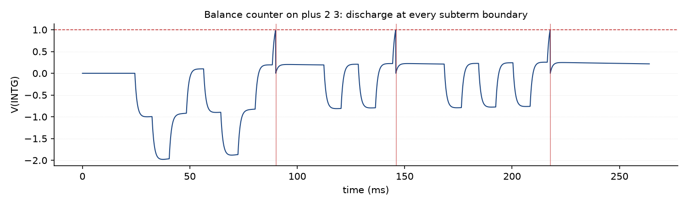

# Spiking lambda-calculus beta-reduction: an independent reproduction

An independent, from-scratch reproduction of the fully spiking neural
implementation of lambda-calculus beta-reduction presented in
[arXiv:2611.23182v1](https://arxiv.org/abs/2611.23182v1) (Lazovskiy,
Kazantsev, Stasenko, November 2026). No code from the authors was
available, so every circuit was rebuilt from the paper's Section 2 and
validated against a symbolic oracle.

Two engines implement the same neural semantics:

* a pure-Python engine (standard library only), used as the reference;
* a bit-faithful C core (`snn_core.c`) driven through ctypes, verified
  spike-for-spike against the Python engine.

Every stage of Algorithm 1 runs on real simulated neurons: Jeffress
delay-line redex detection with a WTA latch, a tau_m = 300 ms balance
counter for subterm segmentation, theta-gamma variable binding, a
phase-ring for De Bruijn arithmetic, theta-cycle STDP token copying, and
PERSIST/GATE/SCAN orchestration.

## Validation highlights

* Calibration reproduced exactly: epsilon(2,1) = 0.263, epsilon(10,2) =
  0.137, epsilon(300,1) = 0.00344 (difference 0.0 between engines).
* The closed loop normalises the paper's terms in the same number of
  reduction steps: PLUS 1 1 in 6, MULT 2 2 in 7, MULT 2 3 in 7, PRED 3 in
  11, if-true (2 I) omega in 8. The `2 I` trace is 10 -> 8 -> 5 -> 2
  tokens.
* DET fires a single spike at 9.10 ms on `2 I` (paper: 8.9 ms), in both
  engines.
* Scale: chains of nested identities up to 449 tokens and 149 reduction
  steps; the C core runs the full closed loop in 1.2 s.
* Living cube: the next cube is written slot by slot by the STDP copy
  circuits (one copy channel per slot, 7 phase channels per token) and
  read back through recall dynamics. Corrupting one learned weight
  stops the reduction, which shows the state really flows through the
  memories. An interruption test rebuilds the cube from the captured
  STDP weights alone after 2 reduction steps (no symbolic state): the
  term is read back from the memories and the reduction continues to
  the same final form, with the dynamical state (potentials, traces,
  refractories) re-initialized, not restored (`run_cube.py`).

See `docs/authors_note_draft.md` for the technical note that accompanies
this repository (fixes, envelope analysis, noise study), and
`bench_scale_results.md` for the scaling measurements.

## Figures

Generated from the real circuits (`python make_figures.py`):





## Quick start

Python 3.8+, standard library only.

```
python run_demo.py        # lambda oracle + LIF/STDP primitives
python run_loop.py        # closed-loop Algorithm 1 on real terms
python run_cube.py        # closed loop with the STDP-written living cube
python run_robustness.py  # the paper's validation blocks
python run_noise.py       # Monte-Carlo noise study of the binding circuit
python run_multiplex.py   # sequential vs multiplexed write cost comparison
python run_stress.py      # stress: depth-scaled BIND bus, wide INTG bodies
```

To enable the C engine:

```
gcc -O2 -shared -fPIC -o libsnn_core.so snn_core.c -lm  # Linux/macOS
gcc -O2 -shared -o snn_core.dll snn_core.c -lm        # Windows
python run_snn_core.py    # differential test: Python engine vs C engine
```

## Layout

| File | Contents |
|---|---|
| `lambda_beta.py` | symbolic oracle: parser, capture-safe substitution, normal-order reduction |
| `bridge_db.py` | names <-> De Bruijn <-> flat prefix tokens, theta-gamma phase encoding |
| `snn_engine.py` | reference engine: exact exponential CUBA-LIF, PSCs, axonal delays |
| `det_redex.py` | redex detection (Jeffress + WTA latch), Section 2.4 |
| `intg_body.py` | balance counter + ARG_MODE, Section 2.5 |
| `bind_gamma.py` | theta-gamma binding circuit, Section 2.6 (+ noise / FREE_F options) |
| `ring_phase.py` | phase-ring De Bruijn arithmetic, Section 2.7 |
| `copy_stdp.py` | one-shot theta-cycle STDP copy, Section 2.8 |
| `cube_state.py` | the next cube as live STDP state: one copy channel per slot, recall-based readout |
| `cube_write.py` | slot-pattern composition from the emissions (ring shifts, re-scan anchoring) |
| `rescan_circuit.py` | neural re-scan: INTG stack per level + ordinal BIND bus |
| `cube_multiplex.py` | shared-chain multiplexed write (m1-m4) |
| `gated_chain.py` | neural GATE_BOUND: routed projections + LIF gate per tap (m5) |
| `persist_gate.py` | PERSIST / GATE / SCAN, Sections 2.9-2.10 |
| `free_vars_fix.py` | reserved phase code for free variables (fix for Section 3.3) |
| `orchestrate.py` | closed-loop Algorithm 1 with topographic event assembly |
| `snn_core.c` / `snn_core.py` | bit-faithful C core + ctypes wrapper |
| `run_*.py` | one validation bank per stage, plus robustness, noise, multiplexing and stress |

## Scope: what runs on spikes, what runs in Python

The paper draws this boundary explicitly (Section 2.11): "Python code
only: (i) initialises the working-memory cube from the input term;
(ii) calls net.step(dt) in the simulation loop; (iii) reads the result
after HALT."

This reproduction follows the same split:

* **On simulated neurons**: redex detection, subterm segmentation,
  argument-mode signalling, variable binding, the phase-ring shift,
  theta-cycle STDP copying, and the PERSIST/GATE/SCAN orchestration.
  Each circuit is validated against a symbolic oracle in isolation.
* **In Python (the meta-controller)**: cube initialisation, event
  collection and topographic ordering, and the per-step oracle
  comparison.

**The cube as live state.** With `living_cube=True` (used by
`run_cube.py`), the next cube is written slot by slot by the STDP copy
circuits and read back through recall dynamics: the tokens consumed by
the next reduction step come out of the copy memories, not out of a
symbolic re-encoding. The slot patterns are composed from the current
term's emissions: copies of the source patterns, phase-ring shifts for
the inserted argument tokens (the carry is read off the ring's observed
wraps), and, for the kept body tokens, the anchored depth counter and
the ordinal BIND wave of the real re-scan circuit (v3c; the nested-SCAN
stack of `rescan_circuit.py`). The KEEP depth decrements are therefore
no longer applied by the meta-controller: the anchored re-scan counter
IS the decrement, and the binder depths are read off the live INTG
stack by the physical BIND bus. The only channel-level rule left in the
meta-controller is the -1 on the free-variable index (free indices
count lambdas above the body, which the scan does not traverse: the
same status as the paper's own Python, Section 2.11; a neural free
port is future work). Differential tests check the composition against
the re-encoding canal by canal on every step, for both the symbolic
reference and the neural path. Each slot stores 7 phase channels: the 4
paper channels (self and binder phases), a type channel (the paper
carries token identity on distinct populations, Section 2.1), and 2
channels for the free-variable index; for bound variables the index is
already recoverable from the binder channels (n = d - 1 - b). Any
silent channel is detected at readout, so a corrupted memory stops the
loop instead of silently corrupting the reduction.

**Multiplexed argument copies (an alternative to Section 2.10.2).**
The paper's Section 2.10.2 creates one nested-SCAN chain `pos_arg`
PER bound occurrence, triggered with staggered delays (O(n_bound)
chains). Our multiplexed write addresses that cost differently: with
`multiplexed=True` (the production default), writing the argument into
the cube no longer costs one full copy per bound occurrence: a single
chain of shared theta windows (one per argument token) serves ALL
occurrences at once, every destination bank learning its ring-routed
pattern during the same windows (emission cost `l_arg` instead of
`n_bound x l_arg`; the per-slot memory is unchanged, slots are
addresses). The per-tap routing stays on the real phase ring, the tap
gating remains meta-controller (the Section 2.11 boundary), and the
differential benches prove the tapped weights are bit-exact against
direct writes and invariant under tap interleaving, on both engines.
The neural write path is closed-complete in the operational sense:
for closed terms, the cube carries the complete state required for
continuation and reduction; for terms containing free variables whose
indices depend on binders outside the scanned body, the index update
remains meta-controlled (the scan cannot see binders above the body),
so the path is hybrid exactly there.
The formal cost comparison (m4, `run_multiplex.py`) measures simulated
theta cycles, SRC events, DST spikes, fan-in and allocated resources
for both modes on the (n_bound, l_arg) family at bit-exact output
equality: the simulated copy time drops by the predicted factor
(up to 6.1x at n_bound=8) while the per-slot memory and the per-bank
fan-in are unchanged; the literal SRC-event count includes the routing
relays (the same spikes arriving through gates in a physical
realization).

**Neural GATE_BOUND (preliminary, `gated_chain.py`).** The window
selection is then moved into neurons: every destination tap receives
every window through routed projection tables laid down at creation
from the ring-composed patterns (wiring, not re-scheduled events), and
a LIF gate per tap (Section 2.9 mechanics: arm current during its own
window) selects what is learned. The SRC events drop to the theoretical
minimum (the chain's raw emission only), and the routing cost moves
into fan-in and wiring: the diffuser delivers every window to every
tap, so the per-tap fan-in rises from 42 to `l_arg x 42` events and the
routing tables count as a resource (`n_arg x l_arg x 7` entries).
Final weights and recall are bit-exact against direct writes. This
block is a Python-only reference implementation; the production write
path still uses the event-based multiplexed chain on both engines, and
the C port (with a per-step gated tonic and tick-order determinism
between the gate and the arriving STDP events) is future work.

**Ablations.** `run_ablation.py` disables one circuit at a time (DET,
INTG, binding, phase ring, re-scan; the STDP copy is covered by the
in-loop sabotage of `run_cube.py`): every ablation is CAUGHT by the
structural cross-checks of the loop: the reduction never computes a
silently wrong result, it stops. Conversely, the neural paths and
their symbolic references (KEEP rules, sequential copy, re-encoded
state) produce identical traces: those switches are modes, not
weakenings.

## Status and limits

All 20 validation benchmarks pass. Known limits, documented in the note:
the balance counter drifts on wide bodies even with the tau_m >= 1000 ms
fix (on the measured x^n shape the discharge is exact at 15 tokens and
wrong at 39), and the binding circuit has a measured sensitivity to
one-bit phase noise: a majority vote over repeated multi-bit
presentations eliminates the false bindings at 5 % noise (k=7: 0/40,
and 0/300 over three seeds on the critical term at both 5 % and 10 %)
and halves them at 10 % (residual open; see the noise study).

Related paper: arXiv:2611.23182v1. This repository is an independent
reimplementation for review purposes; it is not the authors' code.
